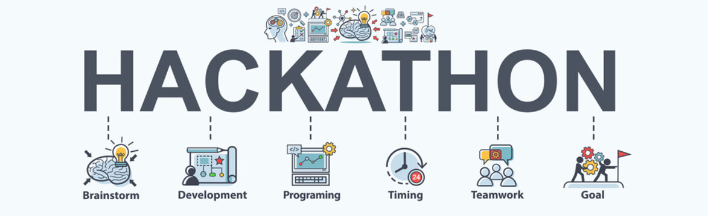

<div align="center">

# 🍲 Suggestion By Anna (suggestion-by-anna)

### *Smart Full-Stack Indian Recipe Recommender & Kitchen Assistant*


</div>

---

## 📌 Overview

**Suggestion By Anna** (`suggestion-by-anna`) is an authentic, intelligent Indian Recipe Recommender and Kitchen Assistant. Built as a complete full-stack web application with **Python Flask**, **Streamlit (WebRTC Smart Fridge)**, **SQLite**, **Scikit-Learn (TF-IDF & Cosine Similarity)**, **OpenCV**, **MediaPipe**, **gTTS**, and **LLM API**.



---

## 🌟 Key Features

1. **⚡ Instant Reverse Recipe Engine**:
   - Recommends authentic Indian recipes matching available kitchen ingredients using TF-IDF vectorization and cosine similarity in **<50ms**.
   - Filters by Diet (Vegetarian, Non-Vegetarian), Regional Cuisine (North, South, West, East, Central), and Meal Course.
   - Shows live **Calories, Protein, Carbs, Fat nutrition breakdown** and health wellness tags (`High Protein`, `Low Calorie`, `Fiber Rich`).

2. **🧊 Smart Fridge Vision & AI Cooking Coach (Streamlit + WebRTC)**:
   - **Streamlit**: Modern interactive dashboard
   - **WebRTC**: Real-time webcam/camera streaming (`streamlit-webrtc`)
   - **MediaPipe & OpenCV**: Real-time pose/hand tracking, HUD overlays, crosshair scanning & color enhancement
   - **SQLite**: Database integration with pantry inventory
   - **gTTS**: Google Text-to-Speech audio guidance speaking out loud in Hindi & English
   - **LLM API**: Gemini & culinary intelligence engine for real-time cooking and chef tips

3. **🎙️ Hands-Free Voice Search (Speech-to-Text)**:
   - Mic button in the search bar allowing users to speak ingredients in Hindi/English while cooking.

4. **🧺 Persistent Kitchen Pantry Manager (SQLite Database)**:
   - Save and track ingredients in your kitchen categorized by Vegetables, Dairy, Spices, Grains, and Oils.
   - **"Cook with My Pantry"**: 1-click discovery that automatically passes all stocked pantry items into the recommender.

5. **❤️ Favorites & Bookmarks**:
   - Save favorite recipes directly into the database with one click.
   - Quick access to watch YouTube video tutorials or start cooking anytime.

6. **📅 7-Day Weekly Meal Planner**:
   - Organize and schedule meals from Monday to Sunday across Breakfast, Lunch, Dinner, and Snacks.

7. **🛒 Smart Grocery Checklist**:
   - 1-click addition of missing ingredients from any recipe directly to your shopping list.
   - Check off purchased items while shopping, move bought items to Pantry, or clear completed items.

8. **🧑‍🍳 Personalized AI Master Chef Studio**:
   - Custom recipe generator with tailored spice levels, cooking times, and secret culinary pro tips.

9. **🖨️ Printable Recipe Cards**:
   - 1-click print / PDF export formatted for kitchen use.

10. **🌐 Interactive API Playground & Documentation**:
    - Swagger-style interactive playground at `/api/docs` and production health check at `/api/health`.

---

## 🧮 Mathematical Formulation & ML Pipeline

```
Feature Vector Construction:
  V = [ TF-IDF(Ingredients)  ||  TF-IDF(Diet)  ||  TF-IDF(Course)  ||  TF-IDF(Region) ]

Cosine Similarity Metric:
  Similarity(A, B) = (A · B) / (||A|| × ||B||)
```

1. **Text Preprocessing**: Normalization, tokenization, and stop-word removal on ingredients and meal attributes.
2. **Multi-Vector TF-IDF Encoding**: Feature matrices generated and saved as compressed NumPy sparse arrays (`.npz`).
3. **Similarity Engine**: Fast matrix dot-products to output top-K recommended recipes in under 50ms.

---

## 🏗️ Architecture & Project Structure

```
Recipe_Recommender/
│
├── database/
│   ├── db.py                 # SQLite connection manager & CRUD service
│   └── recipes.db            # Persistent SQLite database (Pantry, Favorites, Shopping, Meals, Reviews)
│
├── fridge_app.py             # Streamlit + WebRTC + MediaPipe + OpenCV + gTTS Smart Fridge AI
├── run_fridge_ai.bat         # 1-Click launcher for Smart Fridge Streamlit Assistant
│
├── app.py                    # Flask server & REST API controller
├── nutrition_service.py      # Macro-nutrition & dietary health intelligence
├── image_cache.py            # High-speed image and YouTube video caching service
├── templates/
│   └── index.html            # Single-page interactive frontend with tabbed navigation & live sync
│
├── run.bat                   # 1-Click launcher script for main web app (Flask)
├── requirements.txt          # Dependencies
├── recipe_names.pkl          # 195 authentic Indian recipe names
├── tfid_ingredients.pkl      # Ingredient TF-IDF vectorizer
├── tfid_diet.pkl             # Diet TF-IDF vectorizer
├── tfid_course.pkl           # Course TF-IDF vectorizer
├── tfid_region.pkl           # Regional cuisine TF-IDF vectorizer
└── input_features.npz        # Precomputed sparse feature matrix
```

---

## 🚀 How to Run

### Method 1: Main Full-Stack Web App (Flask + SQLite)
Double-click `run.bat` or run:
```powershell
python app.py
```
👉 Open browser: **http://127.0.0.1:5000**
👉 Interactive API Docs: **http://127.0.0.1:5000/api/docs**

### Method 2: Smart Fridge Vision & AI Coach (Streamlit + WebRTC + MediaPipe)
Double-click `run_fridge_ai.bat` or run:
```powershell
streamlit run fridge_app.py
```
👉 Open browser: **http://localhost:8501**

---

## 📄 License

This project is open-source and available under the **MIT License**.
